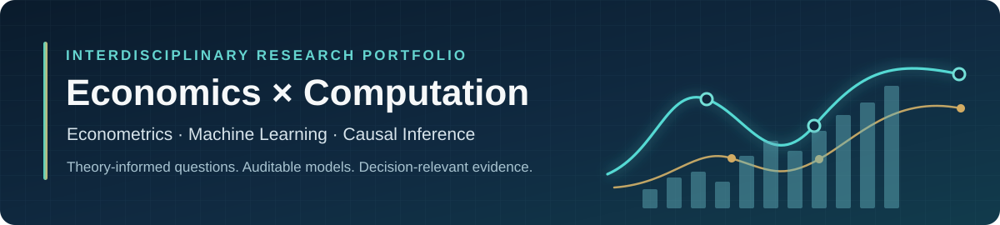

# Muhammad Siddique, PhD

**Computational Economist · Educational Data Science & AI/ML Researcher · Interdisciplinary Quantitative Researcher**

AI in Education · Economics of AI · Learning Analytics · Causal Inference

[**Google Scholar**](https://scholar.google.com/citations?user=0Dthp5IAAAAJ) · [**LinkedIn**](https://www.linkedin.com/in/muhammad-siddique-phd-72954785/) · [**Research Projects**](#selected-research) · [**Methods & Tools**](#analytical-expertise)

---

## Research identity

I conduct **interdisciplinary quantitative research** at the intersection of **Computational Economics, Educational Data Science, and Responsible AI/ML**. Integrating economic theory with **Advanced Econometrics, Statistical Learning, and Explainable AI**, I investigate human capital development, student outcomes, and institutional performance. My work connects substantive research questions with rigorous measurement, reproducible computation, robust inference, and transparent predictive evaluation—producing evidence relevant to academic scholarship, educational improvement, and public policy. I am particularly interested in **AI in Education and the Economics of AI**, including their implications for learning, human capital, and institutional decision-making.

My expertise spans **Econometric Modeling, Quantitative Research Design, Machine Learning, and Causal Inference methodology**, with focused applications in **Learning Analytics, Educational Assessment, Student Success, and Institutional Research and Effectiveness**. I develop end-to-end analytical workflows encompassing data validation, model specification, sensitivity analysis, out-of-sample testing, and interpretable reporting. Across research settings, I evaluate bias, confounding, uncertainty, and generalizability, maintaining a clear distinction between **statistical association, prediction, and causal evidence**.

**Academic foundation.** PhD in Economics; EdD with a Computer Science specialization at Judson University (**expected December 2026**); visiting doctoral research fellowship at **Indiana University Bloomington (2022)**. My background also includes [peer-reviewed Applied Economics scholarship](https://scholar.google.com/citations?user=0Dthp5IAAAAJ), university-level teaching, curriculum development, and research mentorship.

> **Research orientation:** Build models that are useful, assumptions that are inspectable, and conclusions that remain defensible under scrutiny.

## U.S. research program | 2026–2027

**Forward research priority:** emerging U.S. challenges in **AI in Education, the Economics of AI, Institutional Research, and Healthcare Access**. New empirical papers will use **authentic, citable U.S. public-sector datasets**, documented source vintages, transparent reproducibility checks, and explicit inferential limits. *The studies below are protocols, not completed analyses or research findings.*

| U.S. research track | Official data foundation | Current stage |
|:---|:---|:---|
| [**AI in U.S. Schools: Adoption, Governance & Equity**](us-studies/01_ai_in_education.md) | [NCES School Pulse Panel](https://nces.ed.gov/surveys/spp/results.asp) — reported school AI policies, training and perceptions | Research protocol; source data not yet independently extracted |
| [**Economics of AI: Business Adoption & Labor Adjustment**](us-studies/02_economics_of_ai.md) | [Census Business Trends and Outlook Survey](https://www.census.gov/hfp/btos/data), with optional official BLS series | Research protocol; no measured AI employment effect claimed |
| [**U.S. Healthcare Access, Need & Geographic Variation**](us-studies/03_health_access.md) | [CMS Medicare geographic variation](https://data.cms.gov/tools/geographic-variation-in-standardized-medicare-spending-state) + [CDC PLACES](https://www.cdc.gov/places/) | Research protocol + [reproducible CDC data-audit starter](us-studies/cdc_places_pilot/README.md) |
| [**Institutional Effectiveness & Student Outcomes**](us-studies/04_institutional_research.md) | [NCES IPEDS](https://nces.ed.gov/ipeds/) + [College Scorecard](https://collegescorecard.ed.gov/data/) | Research protocol; not an AI-treatment evaluation |

[**U.S. research agenda & priorities**](US_RESEARCH_PROGRAM.md) · [**Data provenance & evidence standards**](research-standards/EVIDENCE_POLICY.md) · [**CDC real-data ingestion starter**](us-studies/cdc_places_pilot/README.md)

---

## Selected research

The projects below document established and ongoing work across U.S. and international settings. **Historical observational analyses, original survey findings, working studies, and synthetic experiments are identified separately.** New U.S.-focused studies appear in the research program above and are **not** represented as completed results.

### International Economics & Trade Intelligence

| Project | Research focus & demonstrated scope |
|:---|:---|
| [**Global Trade Network Durability**](https://github.com/muhammad-siddique-research/global-trade-network-durability) | **74,684 link-year observations** from CEPII BACI; network persistence, Econometric association, and out-of-time export-retention screening. *Unpublished working research; partial replication checkpoints.* |
| [**International Trade Unit-Value Analytics**](https://github.com/muhammad-siddique-research/international-trade-unit-value-analytics) | **2.62 million matched bilateral-product links**; fixed-reference measurement, sample-support sensitivity, and robust statistical quality assurance. *Unpublished working research.* |
| [**Pakistan Export Opportunity Intelligence**](https://github.com/muhammad-siddique-research/pakistan-export-opportunity-intelligence) | Public-source BACI assessment of potential product–destination entries, with a **79,004-pair holdout cohort** and Logistic-versus-Boosting evaluation. *Working empirical research; not a causal policy evaluation.* |
| [**Export Diversification & Shock Resilience**](https://github.com/muhammad-siddique-research/export-diversification-shock-resilience) | HS4 product-market entry and cross-period prediction; **20,005 observations** in the 2024 holdout. *Unpublished working study.* |

### Health Economics & Educational Data Science

| Project | Research focus & demonstrated scope |
|:---|:---|
| [**The Price of Care — Beyond Poisson**](https://github.com/muhammad-siddique-research/price-of-care-health-economics) | **20,190 historical RAND HIE observations**; Poisson HC3, NB2, hurdle likelihoods, and Gradient-Boosted Poisson prediction. Demonstrates **model-sensitive inference**; results are *exploratory and noncausal*. |
| [**The Science of Student Thriving**](https://github.com/muhammad-siddique-research/higher-ed-flourishing-prediction-ml-xai) | Original undergraduate survey (**152 complete cases**); HC3-Robust Regression, repeated ML benchmarking, and held-out Tree SHAP. *Collaborative working manuscript; individual-level data are not public.* |
| [**When Early Signals Travel — OULAD**](https://github.com/muhammad-siddique-research/oulad-explainable-ai-student-risk) | **24,835 learners** in the reported historical day-28 cohort; cross-course academic-risk prediction and calibration. *Archived research outputs; a complete independent source-data rerun remains outstanding.* |

### Financial Risk & Computational Systems

| Project | Research focus & demonstrated scope |
|:---|:---|
| [**Network Fragility & Macroprudential Resilience**](https://github.com/muhammad-siddique-research/systemic-causal-gnn) | Network clearing, GAT–GRU prediction, cross-fitted Double Machine Learning, and stress simulations. *Network and intervention results are synthetic, not observed-bank policy effects.* |
| [**Corporate Bankruptcy Prediction**](https://github.com/muhammad-siddique-research/financial-risk-ai) | Financial distress classification using company indicators, ensemble Machine Learning, and SHAP-based model interpretation. |
| [**Medicare Claims Integrity Lab**](https://github.com/muhammad-siddique-research/medicare-claims-an-innovtive-research) | Claims-granularity measurement checks, count Econometrics, and Monte Carlo validation. *Demonstrated on synthetic examples; not real patient claims analysis.* |

**Additional work:** [E-Commerce Purchase Intention](https://github.com/muhammad-siddique-research/ecommerce-purchase-prediction-ml) · [Trade Data Reliability & XAI](https://github.com/muhammad-siddique-research/pakistan-trade-data-reliability-xai) · [All repositories](https://github.com/muhammad-siddique-research?tab=repositories)

## Analytical expertise

| Research capability | Methods, tools & evaluation priorities |
|:---|:---|
| **Applied Econometrics & Causal Inference** | Robust and clustered inference when identifiable; Panel-Data Models; Poisson/NB2/hurdle counts; interaction analysis; Double Machine Learning; identification diagnostics; sensitivity and falsification checks. |
| **Machine Learning & Statistical Learning** | Regularized Models; Random Forest; Gradient Boosting and XGBoost; graph-based prediction; leakage-aware grouped and temporal holdouts; calibration and uncertainty assessment. |
| **Explainable AI & Responsible Analytics** | SHAP, permutation feature importance, subgroup diagnostics, interpretability stability, provenance audits, and the explicit separation of predictive attribution from causal mechanisms. |
| **Computational Research Engineering** | **Python**, pandas, NumPy, statsmodels, scikit-learn, PyTorch, SQL, **Stata**, **SPSS**, **EViews**, Jupyter, Git/GitHub, automated tests, and documented reproducible pipelines. |
| **Economic & Policy Applications** | International Trade, Trade Networks, Export Diversification, Financial Risk, Healthcare Utilization, Educational Outcomes, and policy evaluation design. |

### How I approach evidence

**Theory → Measurement → Identification → Estimation → Validation → Interpretation.** Econometric significance, predictive accuracy, and causal identification answer different questions. I benchmark alternative specifications, document uncertainty and data limitations, and distinguish **published scholarship, working research, genuine historical datasets, and synthetic computational experiments**.

## Academic research, institutional analytics & university teaching

My PhD in Economics, EdD specialization in Computer Science (**expected December 2026**), and university teaching experience support three complementary professional directions: **Postdoctoral Researcher / Research Scientist** in Computational Economics, Educational Data Science, and AI in Education; **Institutional Researcher / Educational Data Scientist** focusing on student success, Learning Analytics, assessment, and institutional effectiveness; and **University Lecturer / Instructor** combining interdisciplinary teaching with applied research.

**Teaching interests** include **Economics of AI, AI in Education, Educational Data Science, Learning Analytics, and Applied AI/ML**, alongside relevant courses in Economics, Econometrics, and Quantitative Methods. I welcome research and teaching collaborations that examine the educational and economic implications of AI and translate rigorous evidence into improved learning and institutional decision-making.

**Rigorous methods · Reproducible evidence · Responsible interpretation**

[**Explore my repositories**](https://github.com/muhammad-siddique-research?tab=repositories) · [**Read my publications**](https://scholar.google.com/citations?user=0Dthp5IAAAAJ) · [**Connect on LinkedIn**](https://www.linkedin.com/in/muhammad-siddique-phd-72954785/)

