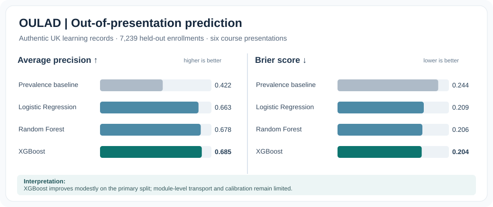

# Muhammad Siddique, Ph.D.

### Applied Economist · Interdisciplinary Quantitative Researcher · Educational Data Scientist

** Applied Econometrics | Applied Computational Research | Machine Learning & Explainable AI | Higher Education Research**

[**Google Scholar**](https://scholar.google.com/citations?user=0Dthp5IAAAAJ) · [**LinkedIn**](https://www.linkedin.com/in/muhammad-siddique-phd-72954785/) · [**Featured Research**](#selected-research-projects) · [**Methodological Expertise**](#research-methods--analytical-specializations)

---

## Research profile

I investigate empirical questions at the intersection of **Applied Economics, Health Economics methods, Computational Social Science, Educational Data Science, and Evidence-Informed Policy**. My health-related portfolio consists of independent computational studies and genuine historical secondary-data analyses, not professional access to restricted patient records. My research integrates theoretical reasoning with rigorous **Econometric Modeling**, reproducible statistical analysis, and **Explainable Machine Learning (XAI)** to distinguish what the data show, what models can predict, and what would require a credible causal research design.

I hold a **Ph.D. in Economics (conferred January 2026)** and am completing an **Ed.D. with a Computer Science specialization at Judson University (anticipated December 2026)**. My research experience includes an externally funded visiting doctoral fellowship at **Indiana University Bloomington**, peer-reviewed work in **International Trade, Finance, and Environmental and Energy Economics**, university teaching, curriculum development, and undergraduate/graduate research mentorship.

**Research principle:** Statistical significance is not predictive validity; predictive attribution is not causal identification. Credible evidence demands careful measurement, transparent assumptions, realistic validation, and substantive interpretation.

## Selected research projects

### 01 · Explainable AI for Early Academic Risk

**Historical UK higher education | OULAD | Robust Econometrics · XGBoost · SHAP**

*Original secondary-data analysis; extended scholarly working manuscript under pre-submission review. Not yet peer-reviewed or published.*

A time-bounded Learning Analytics study of subsequent **Fail/Withdrawn** outcomes using the historic **Open University Learning Analytics Dataset (OULAD)**. The research compares interpretable statistical baselines and tree ensembles, while testing how prediction reliability changes across course presentations and unseen modules.

| Study component | Verified empirical evidence |
|:---|:---|
| Eligible analytic cohort | **24,835 distinct learners** |
| Primary test sample | **7,239 learners; six held-out course presentations** |
| Logistic Regression | Average precision **0.663** · ROC-AUC **0.717** · Brier **0.209** |
| XGBoost | Average precision **0.685** · ROC-AUC **0.724** · Brier **0.204** |
| Econometric inference | HC3-robust and course-presentation-clustered uncertainty for conditional associations |
| Generalization | Time-based validation, unseen-module tests, feature ablation and cutoff sensitivity |

**Research interpretation.** XGBoost exhibits a **modest primary-split ranking advantage**, but performance is context-sensitive. In leave-one-module-out checks, its Brier score was worse than Logistic Regression on **five of seven modules**. The substantive contribution concerns *transportability, calibration, and explainability under changing learning environments*, rather than a claim that algorithmic complexity always improves student-risk assessment.

- **Data attribution:** [Open University OULAD](https://research.stem.open.ac.uk/ouanalyse/dataset/) · [UCI dataset DOI](https://doi.org/10.24432/C5KK69) · [Original scholarly data descriptor](https://doi.org/10.1038/sdata.2017.171).
- **Reproducibility:** Dedicated research repository and detailed analysis package are maintained **privately pending independent review**; access can be discussed for scholarly collaboration.
- **Inference boundary:** Historical UK observational records; **no live AI feedback, robotic assistant, U.S. campus deployment, or causal intervention** was evaluated.

### 02 · The Science of Student Thriving

**U.S. Higher Education | Psychosocial Measurement · Robust Regression · Predictive ML · Tree SHAP**

[**Explore the public research repository →**](https://github.com/muhammad-siddique-research/higher-ed-flourishing-prediction-ml-xai) · [**Read real-data validation notes →**](https://github.com/muhammad-siddique-research/higher-ed-flourishing-prediction-ml-xai/blob/main/docs/REAL_DATA_VALIDATION.md)

*Collaborative scholarly working manuscript; not represented as published or externally validated.*

A single-institution undergraduate survey examines how **Sense of Community, Institutional Integrity, and Spirituality** relate to student thriving. The study integrates theory-based regression and sensitivity diagnostics with internal predictive benchmarking and held-out explanations.

| Analytical layer | Reported finding or research safeguard |
|:---|:---|
| Original survey | **156 respondents; 152 complete cases** |
| Regression fit | **R² = 0.436; adjusted R² = 0.424** |
| Community association | **B = 0.405; HC3 95% CI [0.267, 0.543]** |
| Predictive validation | **Five repeats of 5-fold CV**, seven model configurations |
| XGBoost vs Random Forest | RMSE **0.379** vs **0.380** — practically indistinguishable |
| Model interpretation | Mean absolute held-out SHAP; **not** an estimate of intervention impact |

**Explainable AI — aggregate held-out Tree SHAP**

*Aggregate attribution magnitude in the reported internal study: Sense of Community (0.258), Spirituality (0.130), Institutional Integrity (0.051). The original individual-level survey remains restricted; SHAP measures reliance of the fitted predictor, **not causal importance**.*

**Predictive benchmark — internally held-out error**

[**Interactive Research & Policy Lab (Streamlit) →**](https://higher-ed-flourishing-prediction-ml-xai-cj3qpcffjve46ochqrdtn9.streamlit.app/) · [**Model interpretation and validation protocol →**](https://github.com/muhammad-siddique-research/higher-ed-flourishing-prediction-ml-xai/blob/main/docs/REAL_DATA_VALIDATION.md)

*The Streamlit application is a research-communication and methodological-literacy prototype—not a validated personal risk-assessment or advising system. Survey findings are institution-specific; authorship and research-governance requirements remain subject to confirmation for journal submission.*

### 03 · Additional computational research

| Project | Research contribution | Evidence status |
|:---|:---|:---|
| [**Financial Risk AI: Corporate Bankruptcy Prediction**](https://github.com/muhammad-siddique-research/financial-risk-ai) | Financial-risk classification, model diagnostics and transparent ML-based decision support | Reproducible computational research project |
| [**Network Fragility Under Stress: Financial Contagion, GAT–GRU and Double Machine Learning**](https://github.com/muhammad-siddique-research/systemic-causal-gnn) | Convergence-checked Eisenberg–Noe clearing, paired policy simulations, independent-network GNN and Logistic/Forest/Boosted ML validation, and separately cross-fitted DML | **Executed synthetic benchmark with published tests, figures and uncertainty; no observed-bank causal claims** |
| **The Price of Care — Health Economics (private research repository)** | Real historical RAND Health Insurance Experiment sample (20,190 observations), Poisson HC3/NB2, zero-truncated hurdle and predictive ML | **Genuine historical data; exploratory associations, not randomized causal estimates** |
| **Medicare Claims Integrity Lab — Python (private research repository)** | Claim-granularity quality assurance, synthetic Medicare-compatible ingestion, count-data Econometrics and known-truth Monte Carlo | **Methods demonstration; official CMS-supplied synthetic-file validation remains pending** |
| [**E-Commerce Purchase Intention Prediction**](https://github.com/muhammad-siddique-research/ecommerce-purchase-prediction-ml) | UCI dataset classification, held-out model comparisons, ROC/precision–recall analysis and timing-sensitivity checks | Executed academic benchmarking project |
| [**Peer-reviewed Applied Economics scholarship**](https://scholar.google.com/citations?user=0Dthp5IAAAAJ) | International Trade, competitiveness, Environmental and Energy Economics, financial and policy questions | Published research; bibliographic record on Google Scholar |

**Systemic network research — auditable computational outputs**

*Illustrative Monte Carlo results, not observed bank policy outcomes. See the [research methodology and source-provenance boundaries](https://github.com/muhammad-siddique-research/systemic-causal-gnn/blob/main/docs/DATA_AND_IDENTIFICATION.md).*

## Research methods & analytical specializations

| Research domain | Methods and methodological priorities |
|:---|:---|
| **Econometric Inference** | OLS; Logistic Regression; robust **HC3** inference; panel-data models; clustered uncertainty where identifiers permit; Poisson/NB2/hurdle counts; cross-fitted Double Machine Learning in specified synthetic designs; identification and sensitivity diagnostics |
| **Applied Economic Modeling** | Gravity Models; ARDL / Nonlinear ARDL; Real Effective Exchange Rate; Revealed Comparative Advantage; financial network clearing, systemic risk simulations and controlled stress-test experiments |
| **Predictive Machine Learning** | Regularized Regression; Random Forest; **XGBoost**; LightGBM; **GAT–GRU graph prediction on independently held-out synthetic networks**; grouped and temporal holdouts; leakage-aware preprocessing and validation |
| **Explainable AI and Assessment** | **Tree SHAP**, aggregate attribution, explanation stability, model calibration, Brier score, average precision, ROC-AUC, RMSE and subgroup diagnostics |
| **Educational Data Science** | Longitudinal course activity, student-success and thriving measurement, survey analytics, institutional evidence and responsible learning-support applications |
| **Health Economics & Research Ethics** | Real historic RAND HIE secondary analysis; synthetic Medicare claims workflow; utilization-versus-need distinctions, model adequacy, administrative-data provenance and explicit noncausal limitations |
| **Research Reproducibility** | Python, R, pandas, NumPy, statsmodels, scikit-learn, SQL, Stata, EViews, IBM SPSS Statistics, Jupyter, PyTorch, GitHub Actions and reproducible documentation |

### Methodological approach

The central theme across my portfolio is **triangulation without conflation**:

1. **Econometrics** estimates conditional relationships and quantifies inferential uncertainty, with assumptions made explicit.
2. **Machine Learning** assesses out-of-sample predictive utility against transparent baselines under realistic validation schemes.
3. **Explainable AI** summarizes how fitted models use predictors; **SHAP is not a causal identification strategy**.
4. **Policy translation** considers measurement validity, data privacy, distribution shift, subgroup reliability and the additional evidence required before intervention.

## Teaching, research mentorship & academic background

- **Ph.D., Economics** — National College of Business Administration & Economics, Lahore, Pakistan (January 2026).
- **Ed.D., Computer Science specialization** — Judson University, Illinois (anticipated December 2026); research interests include AI-enhanced learning and Quantitative Educational Research.
- **Visiting Doctoral Research Fellow** — Indiana University Bloomington (2021–2022); longitudinal empirical research in International Trade.
- **University instruction and mentorship** — Economics, Applied Quantitative Methods, research design, curriculum development, and student-led empirical projects.

**Academic interests:** Postdoctoral Research · Educational Data Science · Institutional Research · Econometrics · Quantitative Policy Evaluation · AI/ML for Education and Social Science.

---

### Open methods. Transparent uncertainty. Evidence that can be challenged and reproduced.

[**Scholarship**](https://scholar.google.com/citations?user=0Dthp5IAAAAJ) · [**Research repositories**](https://github.com/muhammad-siddique-research?tab=repositories) · [**Professional profile**](https://www.linkedin.com/in/muhammad-siddique-phd-72954785/)

*Research status, datasets, and methodological limitations are stated alongside each project; no working manuscript is presented here as an accepted publication.*

